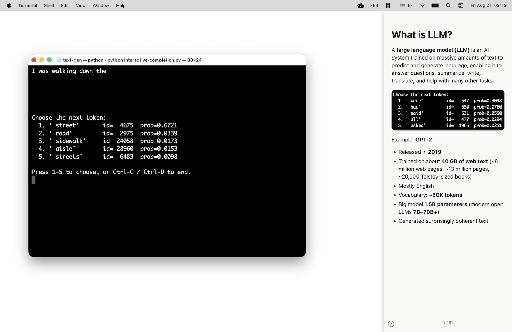
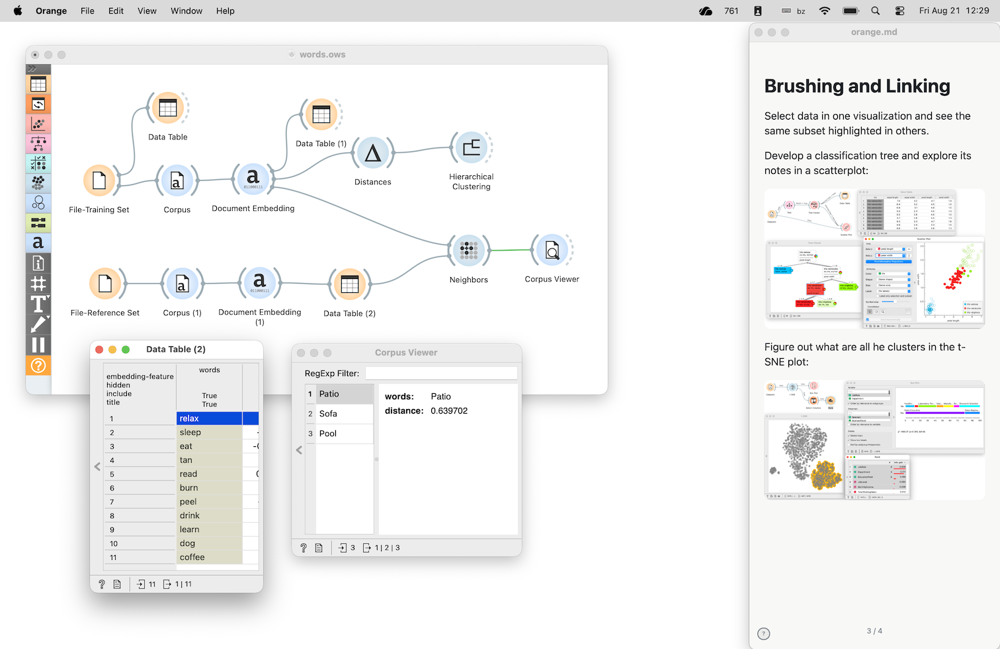

# Talknotes

A small window of speaker notes from a Markdown file, kept beside for hands-on lectures and presentations where the majority of screen will be used for something else.

## About

Most interesting presentations are hands-on. No slides. I think. Though sometimes, we need some slides. But perhaps on the side; other content should be up front.

I built Talknotes for lectures where the real content is a live demo, not a slide deck. My goal was to create an app where the notes are shown in a small, resizable window, where I can easily scale the font sizes up or down, and navigate the slides even when other windows are up front. Another goal was to make the content easily editable in a Markdown file.

There are also hidden cookies in Talknotes: I can copy the quoted text to the clipboard (useful when, say, presenting something that needs a lot of text input, like explaining how chatbots work), click on an image to open it in a full-sized window, or jump to a slide by entering a page number. Also, Talknotes will remeber where you have left the last notes, that is, where was the window, was it with title bar or not, and on which page you have stopped. 

The notes for Talknotes are stored in a Markdown file. Each top-level `#` heading is a slide; the rest is just full-fledged Markdown. The Markdown content defines what is to be shown in the slides, but (intentionally) not how it will be rendered.

## How it looks

Here is an example with the notes from my recent LLM & AI lecture. Notes are on the right, whereas the rest of the screen is used for a demo of sentence completion by LLM that I was running live.



Another example from a hands-on lesson on data science with the [Orange Data Mining](https://orangedatamining.com/) toolbox, where notes are again on the right (I somehow chose that they should be there, though you can position them anywhere) and I work with Orange in the rest of the screen.




## Installation

You need Python 3 and pip. From the project folder:

```bash
python -m pip install -r requirements.txt
```

That installs PySide6 (the window), markdown-it-py, pygments, and pynput.

Global shortcuts (`⌘⌃` plus arrows) are macOS. The window itself is a Qt app and may run on other systems.

## Usage

```bash
python talknotes.py path/to/notes.md
python talknotes.py path/to/directory
```

If you pass a directory, Talknotes opens `directory/directory.md` when that file exists, otherwise the only `.md` file in the folder. If there are a few Markdown files, it asks which one to open.

How a notes file is structured:

- `# Heading` starts a new slide; `##` and `###` are headings on that slide.
- Ordinary Markdown works: lists, tables, links, fenced code, and images next to the file (``).
- Quoted blocks (`>`) can be copied to the clipboard.
- Click an image to open it in its own window.

## Keyboard shortcuts

With the Talknotes window focused:

| Keys | Action |
| --- | --- |
| `←` / `→` | previous / next slide |
| `↑` / `↓` | first / last slide |
| digits + Return | jump to slide number |
| Shift + `+` / `−` | increase / decrease text size |
| `[` / `]` | decrease / increase quoted text size |
| `c` | copy all quoted markdown |
| `m` then 1–9 | copy the *n*-th quoted block |
| `e` | open the markdown file in the default editor |
| `r` | reload the markdown file |
| `d` | toggle dark mode |
| `p` | toggle page numbers |
| `t` | toggle window frame / title bar |
| Option + drag | move the window (frameless mode) |
| click image | open the image in a movable, resizable window |
| `h` / `?` / Escape | show / hide this help |

While another app is focused (macOS):

| Keys | Action |
| --- | --- |
| `⌘⌃←` / `⌘⌃→` | previous / next slide |
| `⌘⌃↑` / `⌘⌃↓` | first / last slide |

`python talknotes.py -h` prints the same lists.

## Examples

Talknotes comes with examples, try them out:

- **[examples/orange](examples/orange)** — a small set of speaker notes for an Orange Data Mining, just text and images and links.
  `python talknotes.py examples/orange`
- **[examples/cycling](examples/cycling)** — another simple image-heavy example with notes on Slovenia and cycling. Try clicking on any of the photos in the notes.
  `python talknotes.py examples/cycling`
- **[examples/markdown](examples/markdown)** — demos Markdown elements (text, tables, code).  
  `python talknotes.py examples/markdown`
- **[examples/copy-quotes](examples/copy-quotes)** — demos the use of quotes that one can copy to the clipboard (using `c`, or `m` then 1–9).  
  `python talknotes.py examples/copy-quotes`
