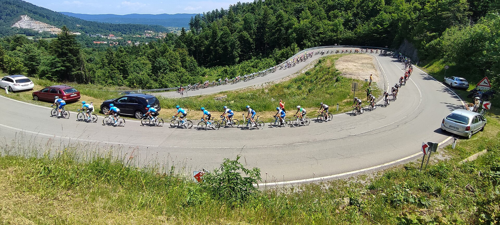
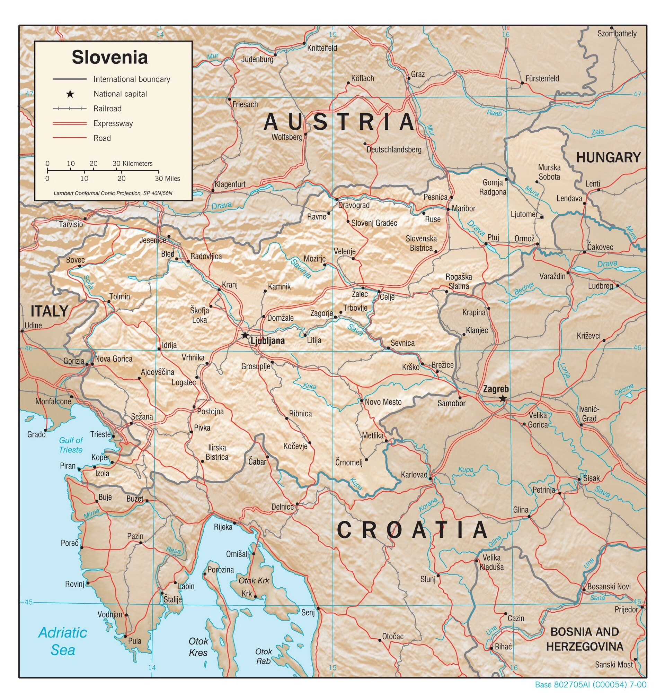
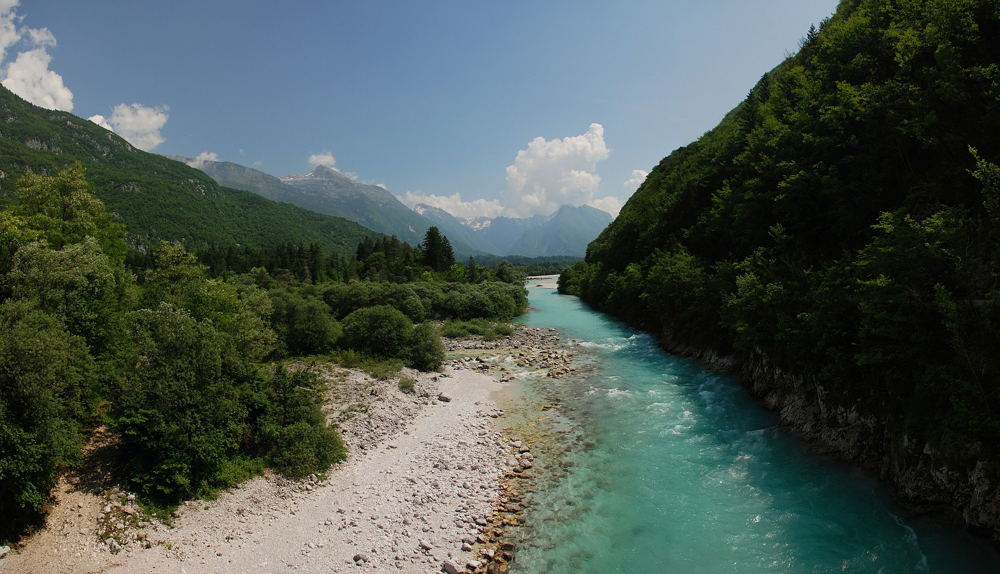
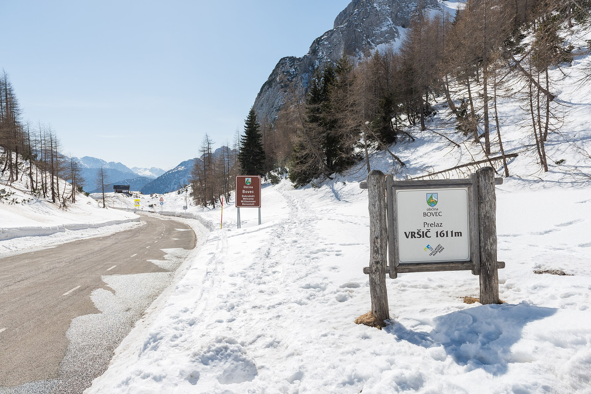
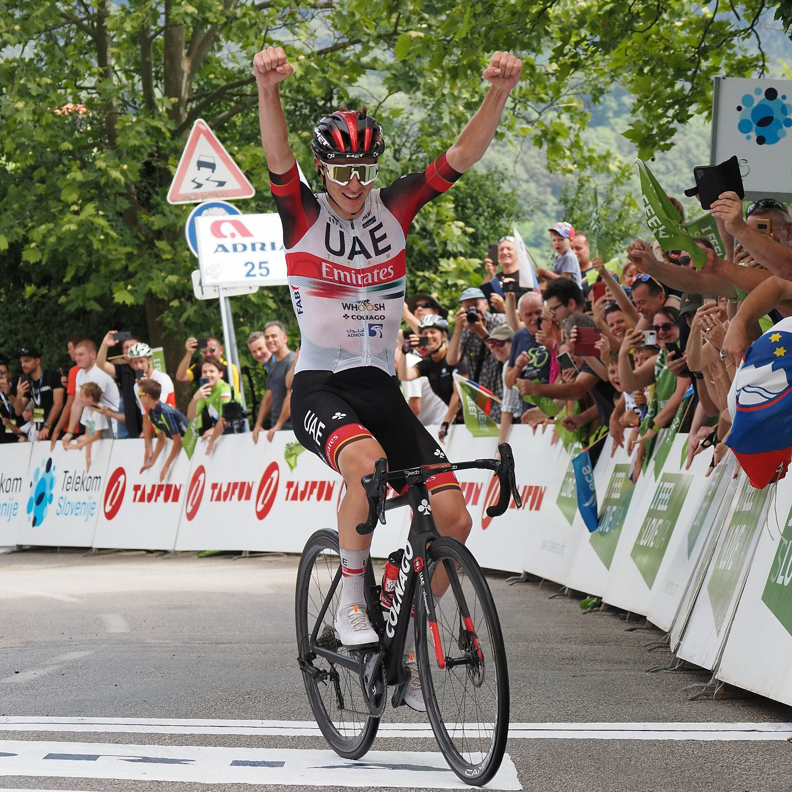
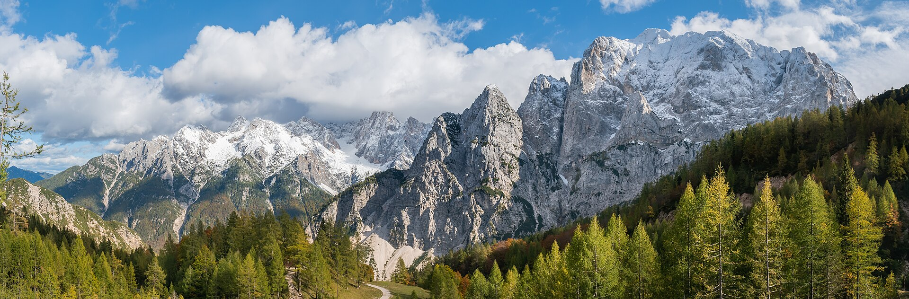

# Cycling in Slovenia

From the Julian Alps to the Adriatic, a small country built for the bike.

# A Compact Map

Alps, karst, and a strip of coast sit close enough to ride in one trip.

* Northwest: Julian Alps and high passes
* Interior: rolling karst and wine hills
* Southwest: the Adriatic at Koper and Piran

# Landscapes

Lake Bled, the turquoise Soča, and passes such as Vršič are the classic riding days.

# Tadej Pogačar

The best cyclist in the world is Slovenian: Tadej Pogačar has won the Tour de France **five** times.

* Titles in 2020, 2021, 2024, 2025, and 2026
* Equals Anquetil, Merckx, Hinault, and Indurain
* Three consecutive Tours (2024–2026)

# A Cycling Country

The terrain that made Pogačar also draws riders to the roads themselves.

* High alpine climbs and quiet valley roads
* A generation of world-class racers from a country of two million
* Start anywhere: the map is small, the landscapes are not

