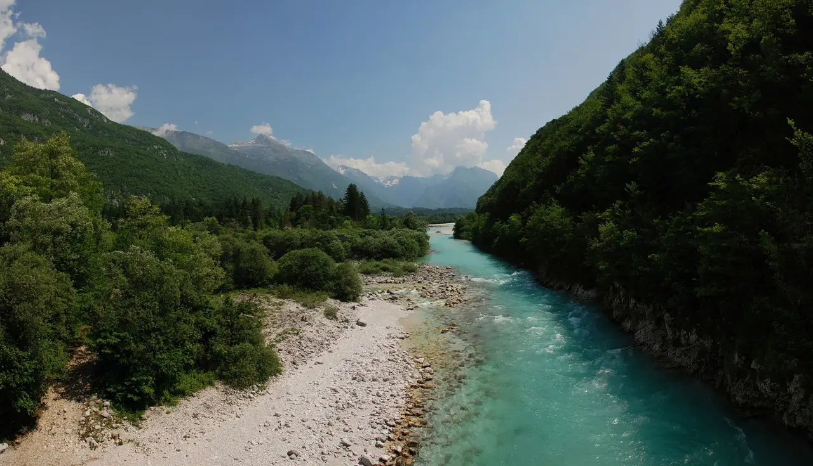
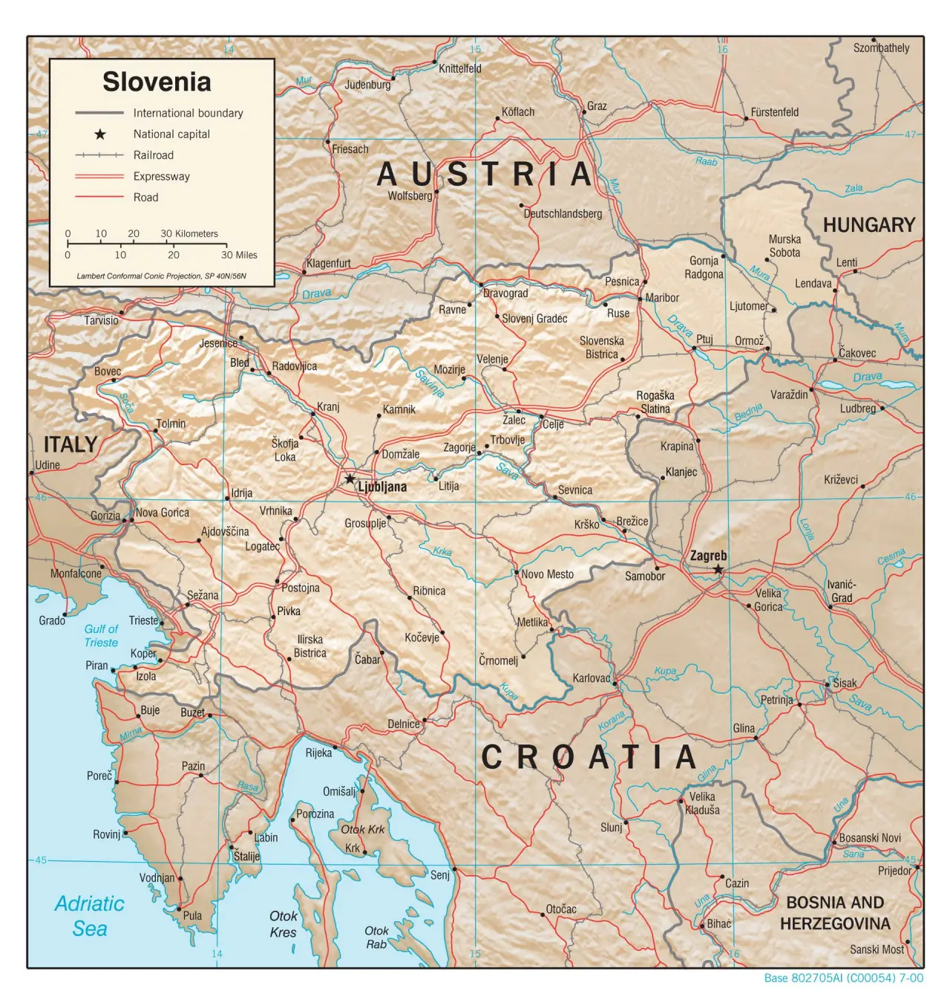

# Galleries

A gallery is a link that opens a set of images in one window. Click the link, then browse:

* `←` / `→` previous / next image
* `↑` / `↓` first / last image
* click the image or press Escape to close

Drag the image to move the window, drag its edges to resize it.

# A Folder of Photos

Link to a folder and every image in it becomes a gallery, in filename order:

[Slovenia by bike](slovenia/)

Number the files to set the order (`1-riders.webp`, `2-map.webp`, …). Numbers sort naturally, so `2-…` comes before `10-…`.

```markdown
[Slovenia by bike](slovenia/)
```

# A Hand-Picked List

List the images after `gallery:`, separated by spaces, inside angle brackets. You choose the order, and the images can come from different folders:

[Orange, then Soča](<gallery: ../orange/fig-orangeimages.png ../orange/fig-tsne-explain.png slovenia/4-soca.webp ../cycling/vrsic.jpg>)

```markdown
[Orange, then Soča](<gallery: ../orange/fig-orangeimages.png ../orange/fig-tsne-explain.png slovenia/4-soca.webp ../cycling/vrsic.jpg>)
```

# Mixing Lists and Folders

A `gallery:` item can also be a folder, which adds all its images. Quote names that contain spaces.

[A tree, then the whole ride](<gallery: ../orange/fig-brush-tree.png slovenia>)

A link to a single image still opens just that image: [Pogačar](slovenia/6-pogacar.webp).

# A Picture with More Behind It

Wrap an image in a gallery link: the image shows on the slide, a badge counts the other images, and a click opens the gallery at this image.

[](<gallery: slovenia/5-vrsic.webp ../cycling/pogacar.jpg>)

```markdown
[](<gallery: slovenia/5-vrsic.webp ../cycling/pogacar.jpg>)
```

# A Picture from a Folder

The same works with a folder link. Clicking opens the folder's gallery at the image you clicked:

[](slovenia/)
