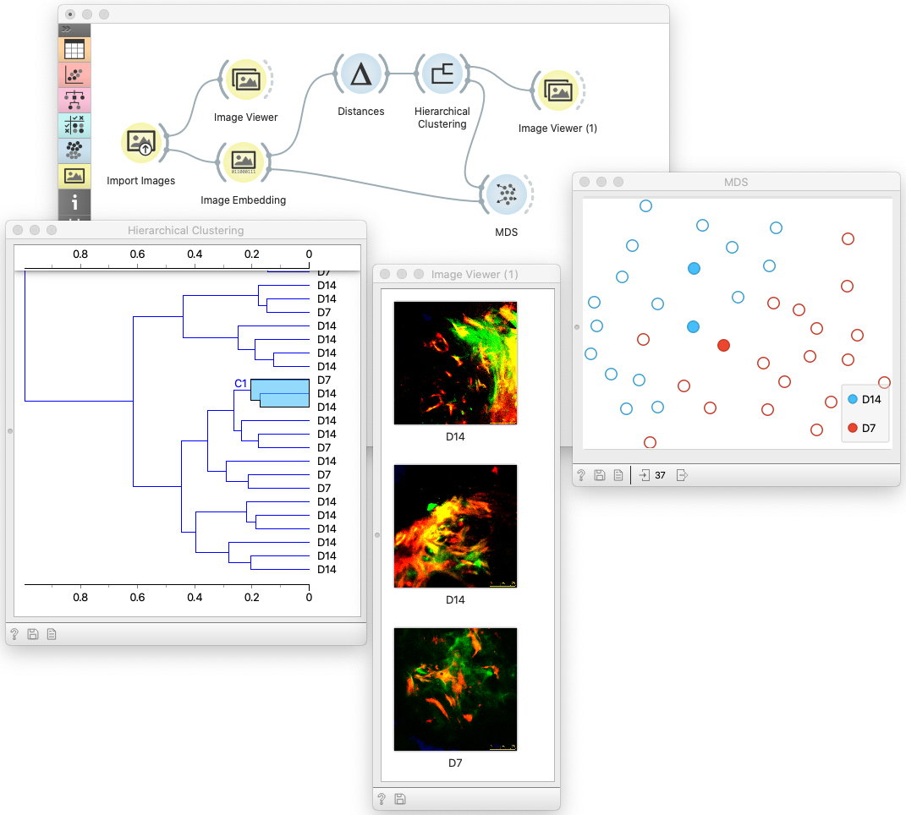
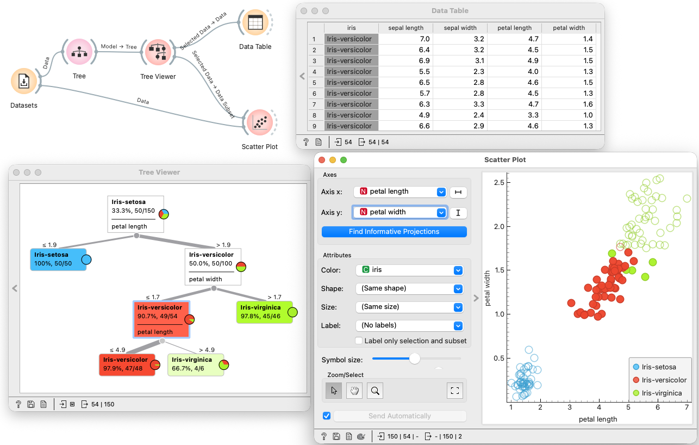
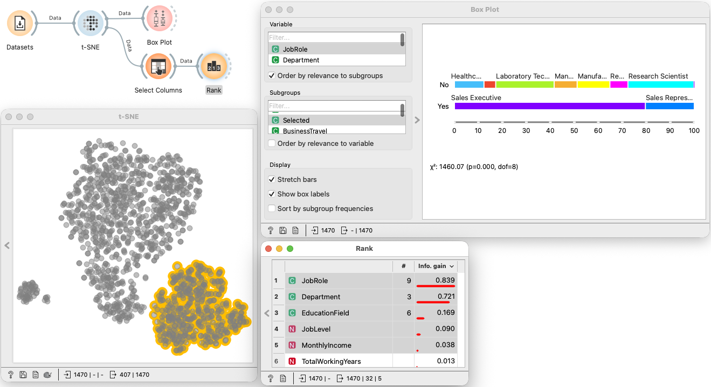

# Orange Data Mining

A free, open source tool for visual analytics and explorative data analysis

(click on an image to display it in full size)

# Visual Programming

Orange is an open-source environment for assembling data analysis from interactive components, with no coding required.

* Widgets on a canvas form the workflow
* Each widget handles one task: load, visualize, model, or score
* The workflow graph makes the analysis explicit
* Changes in one widget propagate to those downstream

# Brushing and Linking

Select data in one visualization and see the same subset highlighted in others.

Develop a classification tree and explore its notes in a scatterplot:

Figure out what are all he clusters in the t-SNE plot:

# Why Orange

Orange combines visual programming with interactive visualization, and is used in data science classes from schools to universities.

* Open source, developed at the University of Ljubljana
* Workflows are inspectable, exchangeable, and reusable
* Start at [orangedatamining.com](https://orangedatamining.com)
